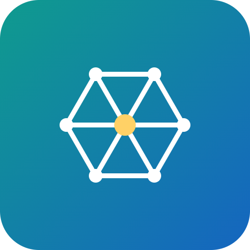

# AirMesh


Crowdsourced, token-rewarded air quality sensing powered by Solana.

## Overview

AirMesh turns everyday phones and cheap sensors into a decentralized air-quality monitoring network. Contributors submit geotagged readings and earn token rewards validated through on-chain consensus, creating hyperlocal environmental data that's currently too expensive for cities to gather.

## Problem

Granular, real-time air quality data is scarce because centralized sensor networks are expensive to deploy and maintain at city scale. Most cities rely on a handful of official sensors, leaving entire neighborhoods without real data.

## Solution

AirMesh is a mobile app plus a lightweight Solana program that lets anyone submit verified sensor readings. Rewards are distributed based on data consistency and multi-source consensus, turning everyday people into a distributed sensing network.

## Features (MVP)

- Mobile app for submitting geotagged, signed sensor readings
- Solana program distributing SPL token rewards based on consensus scoring
- Public map dashboard visualizing aggregated real-time air quality
- Staking mechanism to deter spam or fabricated data submissions
- Open API for third parties to query verified historical data

## Tech Stack

- Anchor (Solana program)
- React Native (mobile app)
- Mapbox (map dashboard)
- Switchboard oracle (consensus/data verification)
- Arweave / IPFS (reading storage)
- SPL Token (rewards and staking)

## How It Works

```
[Phone/Sensor] --signed reading--> [AirMesh App]
       |
       v
[Arweave/IPFS] <--store raw data-- [AirMesh App]
       |
       v
[Anchor Program on Solana]
   - consensus scoring (Switchboard oracle)
   - staking checks
   - SPL token reward distribution
       |
       v
[Public Map Dashboard] <----- [Open API] -----> [Researchers / City Planners]
```

Users submit a signed, geotagged reading from the app. The raw reading is stored on Arweave/IPFS, while a reference and consensus data are processed on-chain. The Anchor program scores submissions for consistency across multiple contributors and distributes SPL token rewards to accurate, honest participants. A staking mechanism discourages spam or fabricated data. Verified data flows into a public map dashboard and an open API.

## Roadmap

- Partner with low-cost hardware sensor manufacturers for calibrated data
- Expand to additional data types like noise and traffic congestion
- Launch a governance token and DAO for network parameter control

## Pitch

- [Pitch deck (PDF)](docs/pitch.pdf)
- [Pitch script](docs/pitch-script.md)

## Team

- [Name] - Role (placeholder)
- [Name] - Role (placeholder)
- [Name] - Role (placeholder)

Built for the Colosseum hackathon.

---

🎬 Pitch video: [docs/pitch-video.mp4](docs/pitch-video.mp4)


## Prototype

Live prototype: https://s25k1063ss-afk.github.io/airmesh/

The source is [docs/index.html](docs/index.html) (served with GitHub Pages from the /docs folder). All data is simulated.
